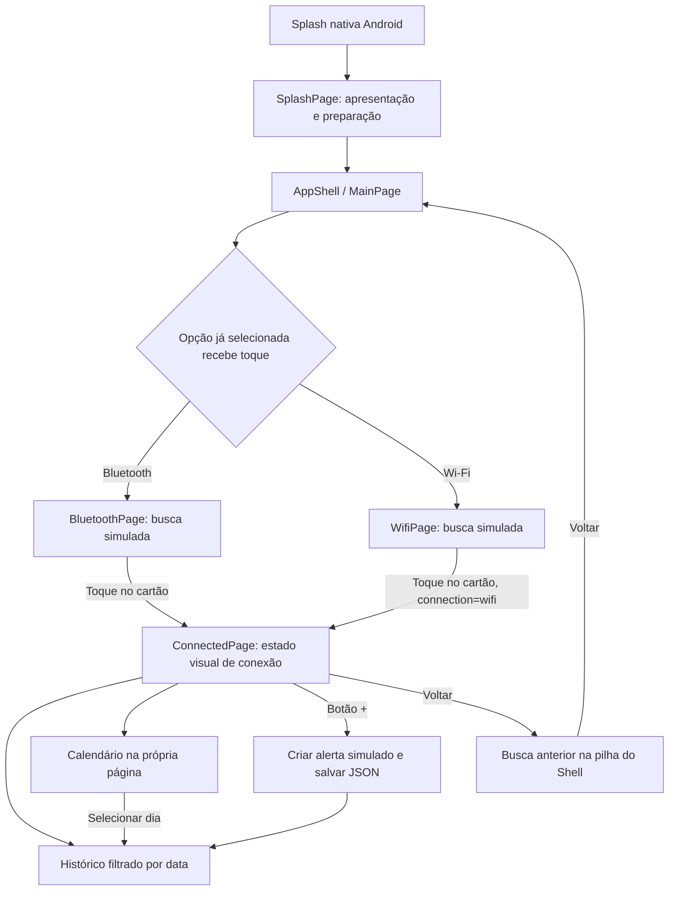
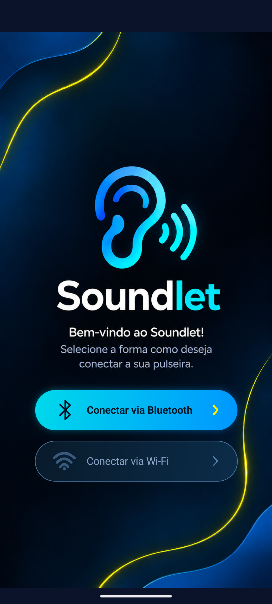
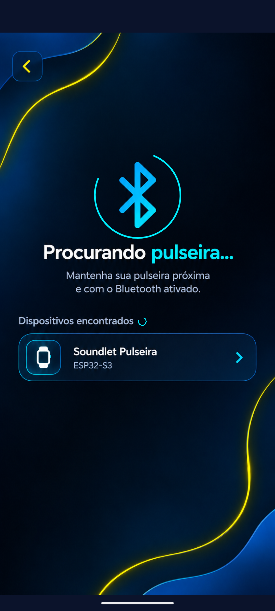
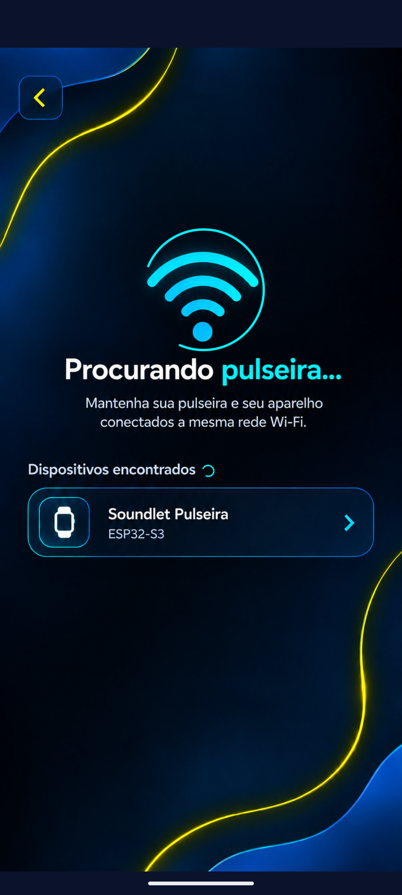
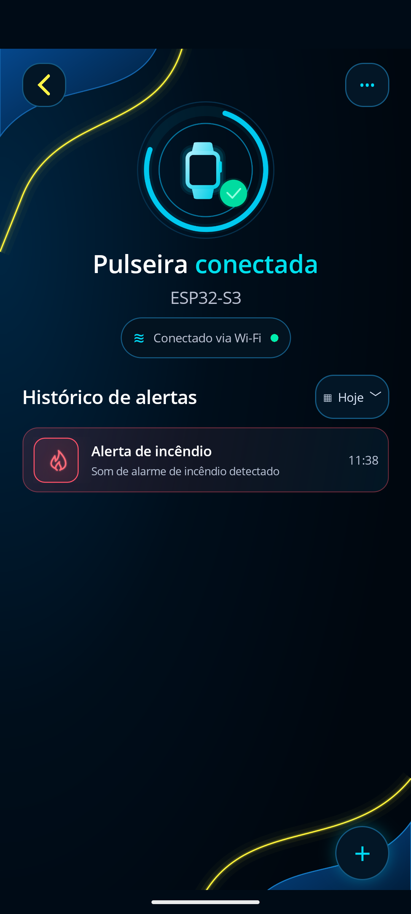
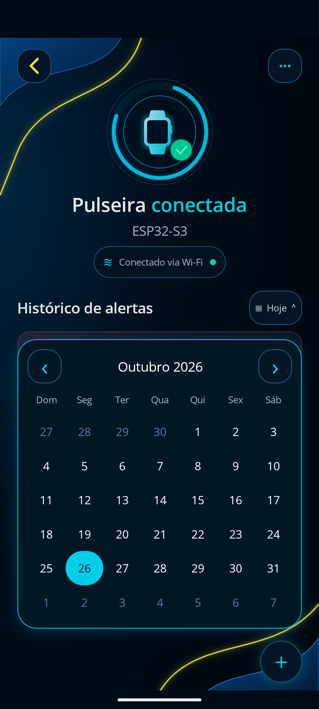

# Soundlet

Aplicativo assistivo para pessoas surdas ou com deficiência auditiva, desenvolvido em **C#, XAML e .NET MAUI 10**. Sua proposta é apresentar alertas visuais de eventos sonoros importantes, em conjunto com uma pulseira baseada no **ESP32-S3**.

**Estado atual:** o aplicativo possui interfaces navegáveis, animações, calendário e histórico com persistência local em JSON. A busca de dispositivos, as conexões Bluetooth/Wi-Fi e a origem dos alertas são **simuladas**. Ainda não há comunicação com a pulseira física nem detecção de sons reais pelo aplicativo.

## Sobre o projeto

O Soundlet pretende auxiliar a percepção de sons relevantes do ambiente por meio de uma pulseira assistiva e de uma interface de consulta no celular. Os seis eventos representados no modelo atual são alarmes de incêndio, batidas na porta, sirenes, campainhas, choro de bebê e latidos de cachorro.

O código implementa a experiência de demonstração: selecionar uma forma de conexão, abrir a busca visual, tocar no cartão da pulseira e consultar ou simular alertas. Os textos de “som detectado” nos cartões são descrições dos tipos de alerta; atualmente, esses registros são gerados pelo botão `+`.

A integração com sistemas embarcados é uma próxima etapa. Este projeto contém o aplicativo MAUI; não inclui uma implementação de firmware ou de reconhecimento de áudio para o ESP32-S3.

## Tecnologias utilizadas

| Tecnologia ou recurso | Função no projeto |
|---|---|
| C# e .NET 10 | Eventos, navegação, modelos, persistência assíncrona e lógica das telas. |
| .NET MAUI / `Microsoft.Maui.Controls` | Projeto único, controles de interface, Shell e APIs de plataforma. A versão do pacote vem de `$(MauiVersion)`, sem número fixo no `.csproj`. |
| XAML | Declaração das páginas, layouts, recursos e estilos. O projeto habilita `MauiXamlInflator=SourceGen` para geração de código na compilação. |
| MAUI Graphics | Desenhos por `IDrawable`, `ICanvas` e `GraphicsView`: opções de conexão, arcos de busca e barra de abertura. |
| Shell | Registro de rotas e navegação com `GoToAsync`. |
| `System.Text.Json` | Leitura e serialização do histórico em JSON, sem banco de dados. Faz parte do .NET. |
| `FileSystem.AppDataDirectory` | Local de armazenamento da aplicação, fornecido pelo MAUI. |
| `Microsoft.Extensions.Logging.Debug` 10.0.0 | Provedor de logs registrado em compilações Debug. |
| Android SDK e ADB | Compilação, instalação e execução em emulador ou aparelho Android. |
| PNG, SVG e fontes Open Sans | Identidade visual, ilustrações, ícones e tipografia. |
| Visual Studio Code | Configurações presentes em `.vscode/`, incluindo habilitação de XAML Hot Reload. |

C# permite organizar eventos, modelos tipados e operações assíncronas no mesmo ambiente. O .NET MAUI reúne interface compartilhada e acesso a recursos de plataforma, enquanto o XAML separa a declaração visual dos métodos que respondem às interações.

Os únicos `PackageReference` da aplicação são `Microsoft.Maui.Controls` e `Microsoft.Extensions.Logging.Debug`. Não há biblioteca BLE, cliente de protocolo de pulseira, ORM ou pacote externo de calendário declarado.

O alvo principal documentado é **`net10.0-android`**, com Android mínimo declarado **API 21**. O projeto também declara `net10.0-ios` e `net10.0-maccatalyst` quando o sistema não é Linux, e `net10.0-windows10.0.19041.0` no Windows. Declarar esses alvos não comprova sua validação em execução.

Git é a ferramenta prevista para versionamento e GitHub é a plataforma planejada de hospedagem. Na revisão desta documentação, a pasta de trabalho não possuía repositório Git inicializado; não há URL remota confirmada.

## Como esse aplicativo foi feito?

As etapas abaixo explicam a construção lógica do código atual. Elas não representam uma cronologia comprovada de desenvolvimento.

### Etapa 1 — Estrutura inicial e inicialização

A solução `Soundlet.slnx` referencia `Soundlet/Soundlet.csproj`. Esse projeto configura os frameworks de destino, o uso de MAUI, a compilação de XAML, a identificação da aplicação, os pacotes e a inclusão dos recursos.

No Android, `MainApplication.CreateMauiApp()` chama `MauiProgram.CreateMauiApp()`. Este cria o aplicativo com `UseMauiApp<App>()`, registra as fontes Open Sans e habilita logs em Debug. As entradas das outras plataformas também encaminham a criação ao `MauiProgram`.

`App.xaml` reúne os dicionários `Colors.xaml` e `Styles.xaml`. Em `App.CreateWindow()`, a primeira página da janela é `SplashPage`. Após a apresentação e a preparação inicial, a página raiz é substituída por `AppShell`, que abre `MainPage`.

### Etapa 2 — Construção da interface

Cada página possui um arquivo `.xaml`, com os controles e layouts, e um `.xaml.cs`, com a classe parcial que executa `InitializeComponent()` e responde aos eventos. O comportamento está concentrado no **code-behind**, isto é, no código associado às páginas; não há camada de ViewModels implementada.

A interface combina três abordagens:

- `MainPage`, `BluetoothPage`, `WifiPage` e `SplashPage` usam imagens PNG com `AspectFill`, sobrepostas por desenhos ou controles transparentes.
- `ConnectionOptionsDrawable` desenha os estados das opções Bluetooth/Wi-Fi. Botões transparentes recebem os toques; `SemanticProperties` descreve sua finalidade e seleção.
- `ConnectedPage` usa controles MAUI para títulos, estado visual de conexão, histórico e calendário. `CreateCard()` constrói em C# os cartões com ícone, texto, horário, bordas e gradientes.

As páginas baseadas em artes usam coordenadas de referência de **850 × 1850**. Métodos como `OnArtworkSizeChanged()` e `PositionIndicators()` aplicam a maior escala entre largura e altura e compensam o recorte central de `AspectFill`. Assim, arcos e áreas de toque acompanham a imagem.

Os SVGs dos alertas, do fundo e da pulseira entram como `MauiImage`; as páginas usam seus nomes `.png`, correspondentes à conversão feita no processamento de recursos MAUI. A presença de imagens antigas, como `soundlet_home.png`, não significa que sejam usadas nas telas atuais.

### Etapa 3 — Navegação entre telas

`AppShell.xaml` define `MainPage` como `ShellContent`, com barras de navegação e abas ocultas. `AppShell.xaml.cs` registra as rotas `BluetoothPage`, `WifiPage` e `ConnectedPage`.

Em `MainPage.SelectOrNavigate()`, Bluetooth começa selecionado. Tocar na opção diferente apenas muda a seleção; tocar na opção já selecionada chama `Shell.Current.GoToAsync()` e abre sua busca. Uma variável de controle impede navegações simultâneas.

Nas buscas, `OnPulseiraClicked()` abre a mesma `ConnectedPage`. O caminho Wi-Fi envia `?connection=wifi`; `ConnectedPage.ApplyQueryAttributes()`, via `IQueryAttributable`, altera o texto e o símbolo exibidos. Sem esse parâmetro, a apresentação é Bluetooth. Essa informação representa o modo visual escolhido, não uma sessão de comunicação com hardware.

Os botões de retorno usam `GoToAsync("..")`: da tela conectada para a busca anterior e da busca para a tela inicial. A abertura não fica na pilha de retorno, pois `SplashPage` é substituída na raiz da janela.

### Etapa 4 — Interfaces de conexão Bluetooth e Wi-Fi

`BluetoothPage` e `WifiPage` mostram artes de busca com dois arcos animados e um cartão fixo “Soundlet Pulseira / ESP32-S3”. Um botão transparente sobre esse cartão permite avançar para a tela conectada.

**Não existe descoberta ou conexão real nessas páginas.** Não há varredura BLE, pareamento, leitura de características GATT, descoberta de rede ou troca de mensagens Wi-Fi. A animação não aguarda resposta de um dispositivo. O aplicativo também não verifica se a pulseira está próxima ou conectada à mesma rede.

O manifesto Android declara `ACCESS_NETWORK_STATE` e `INTERNET`, mas isso, isoladamente, não implementa comunicação. Não há permissões Bluetooth declaradas nem solicitação de permissões BLE em tempo de execução. Na tela conectada, o botão `•••` abre uma mensagem que identifica o modo de demonstração e a integração futura.

### Etapa 5 — Animações e carregamento

| Componente | Implementação |
|---|---|
| Busca Bluetooth e Wi-Fi | `LoadingArcDrawable.Draw()` desenha um arco de 270°. `StartSearchAnimation()` altera sua rotação de 0° a 360°, com atualização solicitada a cada 16 ms e ciclo de 1.400 ms. |
| Ciclo de vida das buscas | `OnAppearing()` inicia a animação; `OnDisappearing()` a interrompe e remove os eventos da janela. `Stopped` pausa e `Resumed` retoma a animação enquanto a página permanece visível. |
| Apresentação de abertura | `SplashProgressDrawable` desenha a barra. `SplashPage.PresentAsync()` anima até 95% em 1.350 ms enquanto `PrepareApplicationAsync()` carrega o histórico e cria o Shell. Depois da preparação, completa a barra em 150 ms e aplica fade de 180 ms. |
| Chegada de alerta | `ConnectedPage.OnAddClicked()` anima a altura do espaço, opacidade, deslocamento e escala do cartão durante 340 ms, com `Easing.CubicOut`. |

A barra da abertura é uma **apresentação visual**, não uma medição percentual do trabalho de armazenamento ou de rede. A parte final aguarda a preparação, mas a duração total pode aumentar se a leitura demorar. Falhas de leitura por I/O ou acesso são registradas na preparação; a tela conectada mantém a tentativa de leitura e a apresentação de erro ao usuário.

### Etapa 6 — Histórico de alertas e persistência

`Models/AlertRecord.cs` define:

- `AlertType`: `Fire`, `Door`, `Siren`, `Doorbell`, `Baby` e `Dog`.
- `AlertRecord`: registro com `Id` (`Guid`), `Type` e `OccurredAt` (`DateTime`).
- `AlertDefinition`: título, descrição, cor e ícone associados a cada tipo por `AlertRecord.Definition()`.

Ao tocar em `+`, `OnAddClicked()` captura **`DateTime.Now` imediatamente**, antes de esperar armazenamento ou animação. Os tipos se alternam na ordem do enum e recomeçam após o sexto. Na primeira abertura de uma instância da tela, o próximo tipo é calculado pelo total de registros carregados módulo seis. Um `SemaphoreSlim` organiza a sequência de inserções na página.

`Services/AlertHistory.cs` centraliza os dados em `AlertHistory.Current`, uma instância compartilhada pelas duas formas de conexão. `LoadAsync()` lê o histórico uma vez por instância; `AddAsync()` cria um identificador, inclui o registro e salva a lista. Outro `SemaphoreSlim` protege leitura e gravação.

O histórico fica em **`alert-history.json` dentro de `FileSystem.AppDataDirectory`**. A lista existe em memória durante a execução e também é persistida em disco; não usa SQLite, banco remoto ou `Preferences`. Os campos visuais derivados são ignorados na serialização com `JsonIgnore`.

A gravação usa `alert-history.json.tmp` e depois move esse arquivo sobre o destino. Se falhar, o registro recém-adicionado é retirado da lista e o erro é propagado. Se a leitura encontrar JSON inválido, copia o conteúdo para `alert-history.json.invalid` e mantém a lista inicial vazia; falhas de acesso ou I/O podem ser informadas pela página.

`RefreshHistory()` filtra por `OccurredAt.Date` e ordena por horário decrescente. `CreateCard()` apresenta o horário em `HH:mm`, usando a cultura `pt-BR`. Não há conversão para UTC ou horário fornecido pela pulseira: o simulador usa o relógio local do aparelho. Sem registros para a data, aparece o estado vazio. Se um alerta for simulado enquanto outra data está selecionada, a seleção volta à data atual para exibi-lo.

### Etapa 7 — Calendário e filtro por data

O calendário é feito com controles MAUI dentro de `ConnectedPage`, sem biblioteca externa e sem página separada.

`CalendarDates.ForMonth()` monta **42 posições**, correspondentes a seis semanas de domingo a sábado. Inclui dias dos meses vizinhos e preserva os limites de `DateTime` com posições nulas quando necessário. `RenderCalendar()` transforma essas datas em botões, destaca a seleção e apresenta o mês em português brasileiro.

`OnDateClicked()` abre a sobreposição no mês atual, preservando a data selecionada. As setas navegam entre meses, com proteção nos limites dos anos 1 e 9999. Selecionar um dia fecha o calendário e executa `RefreshHistory()`; tocar fora ou usar o retorno do Android também fecha a sobreposição. O painel ajusta posição e altura ao espaço disponível e permite rolar as semanas em telas menores.

Esse filtro consulta registros já salvos. Selecionar uma data não cria alertas retroativos nem consulta eventos no hardware.

### Etapa 8 — Personalização Android

O `.csproj` define `ApplicationTitle=Soundlet`, identificador `com.companyname.soundlet`, versão exibida `1.0` e versão interna `1`.

O ícone configurado em `MauiIcon` usa `Resources/AppIcon/soundlet_appicon.svg` como fundo, `soundlet_symbol.png` como primeiro plano, escala `0.85` e cor `#000A14`. O manifesto referencia os recursos normal e redondo `soundlet_appicon`, gerados pelo processamento MAUI.

Há duas partes na abertura: a splash nativa, configurada por `MauiSplashScreen` com `Resources/Splash/soundlet_symbol.png` e fundo `#0B132B`, e a apresentação animada `SplashPage`, executada depois que a interface MAUI está disponível. `MainActivity` usa `Maui.SplashTheme` e oculta a barra de status com APIs específicas para Android 11 ou superior e um caminho alternativo para versões anteriores.

## Estrutura de arquivos e pastas

Árvore resumida dos arquivos existentes; `bin/` e `obj/` foram omitidos.

```text
Soundlet/                         # raiz da pasta de trabalho
├── README.md
├── Soundlet.slnx
├── ANDROID-DEVELOPMENT.md
├── IDENTIDADE-VISUAL.md
├── CLEANUP.md
├── .gitignore
├── .vscode/
│   ├── settings.json
│   └── launch.json
├── Soundlet/                     # aplicação MAUI
│   ├── Soundlet.csproj
│   ├── MauiProgram.cs
│   ├── App.xaml
│   ├── App.xaml.cs
│   ├── AppShell.xaml
│   ├── AppShell.xaml.cs
│   ├── SplashPage.xaml
│   ├── SplashPage.xaml.cs
│   ├── MainPage.xaml
│   ├── MainPage.xaml.cs
│   ├── BluetoothPage.xaml
│   ├── BluetoothPage.xaml.cs
│   ├── WifiPage.xaml
│   ├── WifiPage.xaml.cs
│   ├── ConnectedPage.xaml
│   ├── ConnectedPage.xaml.cs
│   ├── ConnectionOptionsDrawable.cs
│   ├── LoadingArcDrawable.cs
│   ├── SplashProgressDrawable.cs
│   ├── Models/
│   │   ├── AlertRecord.cs
│   │   └── CalendarDates.cs
│   ├── Services/
│   │   └── AlertHistory.cs
│   ├── Resources/
│   │   ├── AppIcon/              # fundo SVG e símbolo PNG
│   │   ├── Splash/               # símbolo da splash nativa
│   │   ├── Images/               # artes PNG e ícones SVG
│   │   ├── Fonts/                # OpenSans-Regular e OpenSans-Semibold
│   │   ├── Styles/               # Colors.xaml e Styles.xaml
│   │   └── Raw/                  # AboutAssets.txt do modelo MAUI
│   ├── Platforms/
│   │   ├── Android/              # MainActivity, MainApplication e manifesto
│   │   ├── iOS/
│   │   ├── MacCatalyst/
│   │   └── Windows/
│   └── Properties/
│       └── launchSettings.json
├── artifacts/                    # apoio e evidências de desenvolvimento
│   ├── connected/
│   │   └── checks/               # Checks.csproj e Program.cs
│   └── wifi/                     # capturas e verificações dos dois fluxos
└── Backups/                      # backup local existente
```

| Arquivo ou pasta | Responsabilidade |
|---|---|
| `Soundlet.slnx` e `Soundlet/Soundlet.csproj` | Solução, alvos, recursos, metadados e dependências. |
| `Soundlet/MauiProgram.cs` | Construção do aplicativo, fontes e logs Debug. |
| `Soundlet/App.xaml` e `.xaml.cs` | Recursos globais e criação da janela com a abertura. |
| `Soundlet/AppShell.xaml` e `.xaml.cs` | Página inicial e registro das três rotas adicionais. |
| `Soundlet/SplashPage.xaml` e `.xaml.cs` | Apresentação animada e preparação do Shell e do histórico. |
| `Soundlet/MainPage.xaml` e `.xaml.cs` | Seleção da forma de conexão e entrada nas buscas. |
| `Soundlet/BluetoothPage.xaml` e `.xaml.cs` | Busca Bluetooth simulada, animação e navegação. |
| `Soundlet/WifiPage.xaml` e `.xaml.cs` | Busca Wi-Fi simulada e envio do parâmetro de navegação. |
| `Soundlet/ConnectedPage.xaml` e `.xaml.cs` | Estado visual da pulseira, cartões, simulador, calendário e filtro. |
| `Soundlet/ConnectionOptionsDrawable.cs` | Desenho dos estados das opções da tela inicial. |
| `Soundlet/LoadingArcDrawable.cs` | Arco reutilizado nas duas páginas de busca. |
| `Soundlet/SplashProgressDrawable.cs` | Desenho da barra de apresentação. |
| `Soundlet/Models/` | Tipos de alerta, definições visuais e cálculo das datas. |
| `Soundlet/Services/AlertHistory.cs` | Leitura, inclusão e persistência compartilhada dos alertas. |
| `Soundlet/Resources/` | Imagens, ícones, fontes, estilos e arquivos empacotados. |
| `Soundlet/Platforms/` | Entradas, manifestos e configurações dos sistemas de destino. |
| `.vscode/` | Configurações do editor; o perfil local de lançamento contém caminho específico da máquina e é ignorado pelo Git. |
| `artifacts/connected/checks/` | Programa de verificações dos modelos e histórico, separado da aplicação. |
| `artifacts/` | Scripts, imagens e registros históricos; não é necessário para compilar o aplicativo. |

## Arquitetura e funcionamento

A aplicação separa páginas, modelos e serviço de histórico. As páginas coordenam eventos e apresentação; `AlertRecord` representa os dados; `AlertHistory` gerencia sua leitura e gravação. O histórico é acessado diretamente pela instância estática `Current`, sem registro próprio no contêiner de injeção de dependências.

### Fluxo de navegação



O diagrama representa navegação visual. Nenhuma transição estabelece uma conexão com o ESP32-S3.

### Fluxo dos dados

```text
Toque em + → captura DateTime.Now → escolhe AlertType
→ AlertHistory.AddAsync → cria AlertRecord com Guid
→ grava lista em JSON → cria e anima cartão na tela

Inicialização / abertura da tela → AlertHistory.LoadAsync
→ lista em memória → filtro pela data → ordenação decrescente → cartões
```

As duas formas de conexão compartilham o mesmo arquivo e a mesma lista. Não há separação de histórico por pulseira, conta ou transporte. O serviço é um ponto possível para receber eventos de hardware futuramente; esse recebimento ainda não está implementado.

## Funcionalidades implementadas

Os itens concluídos descrevem o comportamento confirmado nos arquivos, com as simulações identificadas explicitamente.

- [x] Splash nativa, apresentação animada e ícone Soundlet configurados.
- [x] Seleção visual entre Bluetooth e Wi-Fi, com navegação por Shell.
- [x] Interfaces de busca **simuladas**, com indicadores animados e cartão fixo.
- [x] Tela compartilhada com estado de conexão **simulado** e mensagem de demonstração.
- [x] Geração manual de seis tipos de alertas **simulados** pelo botão `+`.
- [x] Horário local capturado no toque e animação de chegada do cartão.
- [x] Histórico persistente em JSON e apresentação dos registros mais recentes primeiro.
- [x] Calendário próprio, navegação entre meses, filtro por dia e estado vazio.
- [x] Descrições semânticas em controles e cartões e ajustes de layout conforme o espaço disponível.
- [ ] Descoberta e conexão BLE real com a pulseira ESP32-S3.
- [ ] Descoberta e comunicação Wi-Fi real com a pulseira.
- [ ] Recebimento de eventos reais do hardware.
- [ ] Detecção ou classificação de sons reais integrada ao aplicativo.
- [ ] Validação funcional dos demais alvos de plataforma e da acessibilidade com usuários.

## Como executar o projeto

### 1. Pré-requisitos

O roteiro abaixo é voltado ao desenvolvimento Android no Windows, ambiente descrito nos registros locais do projeto.

- SDK **.NET 10**, com workload MAUI compatível.
- Android SDK com **API 36**, build-tools compatíveis, platform-tools e licenças aceitas.
- **JDK 21**, configurado para as ferramentas Android.
- Emulador Android com imagem de sistema e aceleração disponíveis, ou celular Android compatível com depuração USB.
- Visual Studio Code com suporte a C#/.NET MAUI, se desejar usar o editor; os comandos de terminal não dependem dele.
- Git, caso obtenha os fontes por clonagem.

A API 36 é o alvo padrão de `net10.0-android`; ela não deve ser confundida com a versão mínima API 21 declarada pela aplicação. Esses requisitos de compilação estão descritos na documentação oficial de [.NET MAUI 10](https://learn.microsoft.com/en-us/dotnet/maui/whats-new/dotnet-10) e na [instalação de dependências Android](https://learn.microsoft.com/en-us/dotnet/android/getting-started/installation/dependencies).

### 2. Obter os fontes

Quando houver uma URL publicada, substitua o marcador pela URL real. Nenhum endereço de repositório foi confirmado nesta pasta.

```powershell
git clone "URL_DO_REPOSITORIO" Soundlet
cd Soundlet
```

Se você já tem os arquivos, abra diretamente a pasta que contém `Soundlet.slnx`.

### 3. Preparar o workload

Verifique o SDK ativo e os workloads instalados:

```powershell
dotnet --info
dotnet workload list
```

Se o MAUI ainda não estiver instalado:

```powershell
dotnet workload install maui
```

Configure o Android SDK e o JDK nas ferramentas de desenvolvimento. Não é necessário usar os caminhos ou o nome de emulador da máquina original. O `adb` fica em `platform-tools` do Android SDK; inclua essa pasta no `PATH` ou execute-o pelo caminho da sua instalação.

### 4. Restaurar e compilar

Na raiz que contém a solução:

```powershell
dotnet restore
dotnet build -f net10.0-android
```

A restauração da solução pode avaliar outros alvos declarados e exigir seus workloads. Para concentrar restauração e compilação apenas no Android, use explicitamente o projeto e restrinja `TargetFrameworks` nos dois comandos, sem editar o `.csproj`:

```powershell
dotnet restore Soundlet/Soundlet.csproj -p:TargetFrameworks=net10.0-android
dotnet build Soundlet/Soundlet.csproj -f net10.0-android -p:TargetFrameworks=net10.0-android
```

### 5. Executar no emulador Android

Inicie um AVD pelo gerenciador de dispositivos Android ou pelas ferramentas MAUI do editor. Aguarde o sistema terminar de iniciar e confirme que o destino aparece como `device`, em vez de `offline`:

```powershell
adb devices
dotnet build -t:Run -f net10.0-android
```

Se houver vários destinos, consulte o serial em `adb devices` e selecione-o explicitamente:

```powershell
dotnet build -t:Run -f net10.0-android "-p:AdbTarget=-s SEU_SERIAL"
```

O primeiro build pode demorar mais. Em Debug para Android, `EmbedAssembliesIntoApk=true` incorpora as assemblies ao APK; a configuração foi adicionada para permitir alternar entre os destinos padrão ARM64 e x86_64 sem depender do pacote específico de Fast Deployment anterior.

### 6. Executar em um celular via USB

Ative as opções de desenvolvedor e a depuração USB no celular, conecte-o e autorize o computador na tela do aparelho. No Windows, instale o driver do fabricante se necessário. Confirme o estado `device` e execute com o serial do celular:

```powershell
adb devices
dotnet build -t:Run -f net10.0-android "-p:AdbTarget=-s SERIAL_DO_CELULAR"
```

Não é necessário conectar uma pulseira para experimentar a demonstração. Abra uma busca, toque no cartão e use `+` para criar alertas.

### 7. Verificações auxiliares existentes

O projeto contém um programa de verificações para o calendário e a persistência:

```powershell
dotnet run --project artifacts/connected/checks/Checks.csproj
```

Ele reutiliza os modelos e o serviço da aplicação, substitui apenas o diretório de armazenamento MAUI por uma pasta temporária e verifica alinhamento das semanas, limites de datas, sequência de tipos, identificadores e preservação dos registros após leitura do JSON. Ao terminar, remove sua própria pasta temporária. Não testa BLE, Wi-Fi, renderização ou navegação Android.

Os scripts de interface em `artifacts/` são auxiliares: alguns exigem ADB, Python/Pillow e adaptação de caminhos e destino. Eles podem gerar alertas de demonstração no emulador. Essas ferramentas não são dependências da aplicação.

## Estado atual e próximas etapas

O Soundlet está em uma etapa de **protótipo funcional da interface e do histórico local**. A navegação funciona por eventos e rotas; a persistência e o filtro de datas têm implementação concreta. Os indicadores “conectada” e “som detectado” fazem parte do cenário simulado.

As próximas etapas de integração são definir o protocolo de eventos com o ESP32-S3, implementar o transporte BLE ou Wi-Fi, tratar permissões e estado da conexão e encaminhar os eventos reais ao histórico. Também será necessário definir a origem e o tratamento do horário fornecido pelo hardware e validar o comportamento com a pulseira física.

O código atual não possui notificações do sistema ou serviço de recepção em segundo plano. O calendário não sinaliza quais dias têm alertas e a interface não oferece exclusão ou exportação do histórico. Esses pontos permanecem como possibilidades de evolução, não como funcionalidades entregues.

Os registros em `ANDROID-DEVELOPMENT.md` descrevem validações anteriores de build e execução Android, além de limitações do emulador. Esta atualização do README foi baseada na análise dos arquivos e das capturas existentes; não representa uma nova execução de testes no dispositivo. Os outros alvos precisam de validação em seus respectivos ambientes.

## Capturas de tela

Capturas existentes em `artifacts/wifi/`, utilizadas como registros da interface de demonstração. Os alertas e as conexões mostrados são simulados; as imagens não comprovam integração com hardware.

| Tela inicial | Busca Bluetooth | Busca Wi-Fi |
|---|---|---|
|  |  |  |

| Histórico com alerta simulado | Calendário de seleção de data |
|---|---|
|  |  |

## Aprendizados técnicos

- **Orientação a objetos e tipos em C#:** classes de página, `record` para dados de alerta, enum para categorias e interface `IDrawable` para desenho.
- **Interfaces com XAML:** composição de layouts, recursos compartilhados, estilos e associação com code-behind.
- **Eventos e navegação:** tratamento de toques, proteção contra navegação repetida, Shell e parâmetros de consulta.
- **Desenho e animação:** canvas, transformações de escala, invalidação de desenhos e controle pelo ciclo de vida.
- **Persistência assíncrona:** leitura e escrita JSON, sincronização por semáforos e tratamento de falhas de armazenamento.
- **Datas e localização:** calendário calculado, filtro por dia, ordenação e apresentação em `pt-BR`.
- **Compilação Android:** workloads, empacotamento de recursos e seleção de dispositivos com ADB.
- **Preparação para sistemas embarcados:** modelos e caminho de inclusão de alertas que podem receber uma futura integração, ainda ausente.

## Documentação complementar

- [Desenvolvimento Android](ANDROID-DEVELOPMENT.md): diagnóstico, execução e verificações históricas do ambiente local.
- [Identidade visual](IDENTIDADE-VISUAL.md): registros da implementação visual; detalhes históricos devem ser confrontados com o `.csproj` atual.
- [Organização da pasta e preparação para publicação](CLEANUP.md): critérios de preservação, arquivos locais e regras de ignore.

Esses relatórios foram preservados e podem conter caminhos específicos do ambiente original. Eles não definem caminhos obrigatórios para executar o Soundlet em outra máquina.
